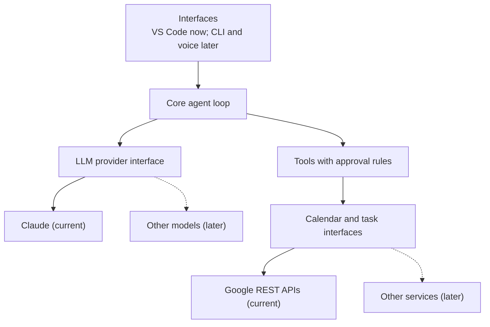

# Savi

A personal assistant in the spirit of Jarvis: tell it what you need in plain language and it acts on your behalf.

Savi is **Claude-first but provider-agnostic**. The assistant logic talks to small interfaces, so the model or the calendar service can be replaced without rewriting it. Integrations call the service's own API directly.

> **Status: early development.** The first milestone is a VS Code extension that manages Google Calendar and Google Tasks.

## Design

Principles:

- **Replaceable parts.** Core code never imports a model SDK, Google code, or VS Code.
- **You stay in control.** Changing or deleting existing items asks for confirmation.
- **Local credentials.** Secrets live in the editor's secret storage, never in the repository or settings files. There is no Savi server.
- **Useful without AI.** The agenda and quick-add commands don't need a model.

## Roadmap

| Milestone | Scope |
| --- | --- |
| **1. Calendar** (in progress) | Chat, agenda view, events, reminders, birthdays, tasks, priority colours |
| **2. Memory** | Preferences and facts you can read, edit and delete |
| **3. Proactive** | Morning briefing, reminders, conflict detection |
| **4. More skills** | Email, notes, GitHub, home automation |
| **5. More interfaces** | Background service, CLI, voice |
